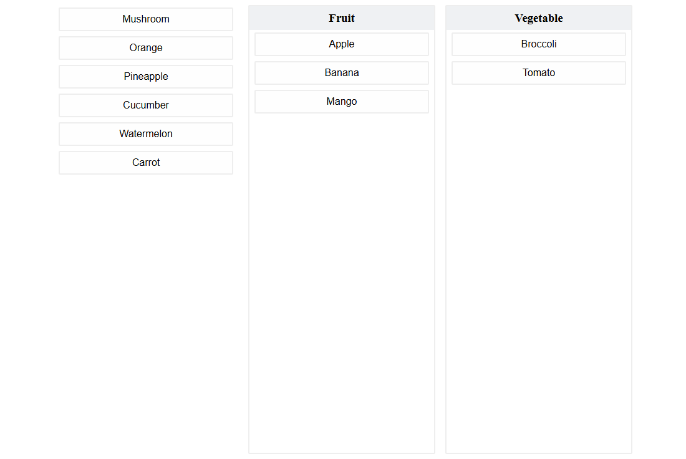

# Auto Delete Todo List

[](https://github.com/anyawee-sr/assignment-auto-delete-todo-list/actions/workflows/ci.yml)

A todo list where clicked items move into a column by type, then return to the main list after 5 seconds.

## Live Demo

**https://assignment-auto-delete-todo-list.vercel.app**

https://github.com/user-attachments/assets/2063bc98-2689-49d1-abcf-3d9757fb84b3



## Assignment

Source: [7-solutions/frontend-assignment: 1. Auto Delete Todo List](https://github.com/7-solutions/frontend-assignment#1-auto-delete-todo-list)

Please make a todo list that:

1. Has a list of clickable buttons.
2. Moves each button into its own column, separated by type.
3. Keeps each moved button on the screen for 5 seconds, then moves it back to the bottom of the main list.
4. Moves an item back to the bottom of the left column (main list) immediately when it is clicked in the right column (Fruit/Vegetable).

The test must be hosted on a hosting service. It is judged on answering the needs of the question and on clean, easy-to-read code. Bonus: alternative solutions can be discussed in the interview.

<details>
<summary>Given data</summary>

```js
[
  { type: 'Fruit', name: 'Apple' },
  { type: 'Vegetable', name: 'Broccoli' },
  { type: 'Vegetable', name: 'Mushroom' },
  { type: 'Fruit', name: 'Banana' },
  { type: 'Vegetable', name: 'Tomato' },
  { type: 'Fruit', name: 'Orange' },
  { type: 'Fruit', name: 'Mango' },
  { type: 'Fruit', name: 'Pineapple' },
  { type: 'Vegetable', name: 'Cucumber' },
  { type: 'Fruit', name: 'Watermelon' },
  { type: 'Vegetable', name: 'Carrot' },
]
```

</details>

## Tech Stack

- **React 19** + **TypeScript**
- **Vite**: dev server and build
- **CSS Modules**: styling
- **Vitest** + **React Testing Library**: unit and component tests
- **Playwright**: end-to-end tests
- **ESLint** + **Prettier**: linting and formatting
- **GitHub Actions**: CI (format, lint, test, build, e2e)
- **Vercel**: hosting

## Getting Started

### Prerequisites

- Node.js 24 (the version used in CI)
- npm

### Run

```bash
npm ci
npm run dev
```

Then open http://localhost:5173.

## Scripts

| Command                 | Description                                   |
| ----------------------- | --------------------------------------------- |
| `npm run dev`           | Start the dev server                          |
| `npm run build`         | Type-check and build for production (`dist/`) |
| `npm run preview`       | Serve the production build locally            |
| `npm run lint`          | Run ESLint                                    |
| `npm run format`        | Format all files with Prettier                |
| `npm run format:check`  | Check formatting without writing              |
| `npm test`              | Run unit tests in watch mode                  |
| `npm run test:run`      | Run unit tests once                           |
| `npm run test:coverage` | Run unit tests with a coverage report         |
| `npm run test:e2e`      | Run Playwright e2e tests (starts dev server)  |

Before the first e2e run, install the browser: `npx playwright install chromium`.

## Editing the Data

All items live in `RAW_TODO_LIST` in [`src/data/rawTodoList.ts`](src/data/rawTodoList.ts). Each item needs only `type` and `name`:

```ts
{ type: 'Herb', name: 'Basil' }
```

- `id` is generated automatically as `` `${type}-${name}` `` by `transformTodoList` in [`src/utils/todoList.ts`](src/utils/todoList.ts), so the same `type` + `name` pair must not appear twice (a unit test checks this).
- Columns come from the `type` values in the data. Adding a new type, such as `'Herb'` above, adds a new column with no UI changes.
- The e2e tests check the assignment's exact list on purpose. If you change the data, update the expected list in [`e2e/todo.spec.ts`](e2e/todo.spec.ts).

## Approach

- Timers live in a single `Map` inside `useRef` in `App`, one per item. Each timer is cleared on an early click and on unmount.
- Column moves are pure functions ([`src/utils/todoColumns.ts`](src/utils/todoColumns.ts)) and are tested in isolation.
- Columns are derived from the data's `type` values.
- The first version kept a `useEffect` timer inside each button. It was refactored so the button only renders and the timing logic lives in `App` ([d833895](https://github.com/anyawee-sr/assignment-auto-delete-todo-list/commit/d833895)).

Alternative approaches (a single interval with timestamps, `useReducer`) are open for discussion in the interview.

## Project Structure

```
src/
├── App.tsx              # Column state and per-item timers
├── components/
│   ├── TodoList.tsx        # Renders a list of todo buttons
│   ├── TodoTypeColumn.tsx  # A titled column for one type
│   └── TodoItemButton.tsx
├── constants/
│   └── todo.ts
├── data/
│   └── rawTodoList.ts   # Raw data (type and name only)
├── types/
│   └── todo.ts
└── utils/
    ├── todoColumns.ts   # Pure functions that move items between columns
    └── todoList.ts      # Pure functions that generate ids and derive types
e2e/
└── todo.spec.ts         # Playwright end-to-end tests
```
